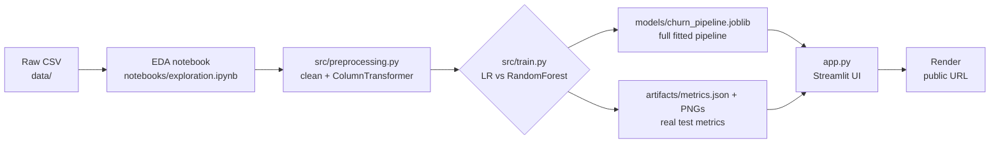

# 🛡️ ChurnGuard — Customer Churn Prediction

An end-to-end machine-learning project that predicts whether a telecom customer is
likely to leave, served through an interactive **Streamlit** app and deployed on
**Render**.

> **Deployment URL:** [https://churnguard-o1j3.onrender.com/](https://churnguard-o1j3.onrender.com/)
> **Live screenshots:** _add after final UI polish — see `notebooks/exploration.ipynb` for charts and Pages 2–4 for the live UI_

---

## Problem statement

For telecom providers, acquiring a new customer costs significantly more than
retaining an existing one — but retention offers are expensive too. The goal:
predict which customers are about to churn so retention budgets are spent on
people who actually need them.

Monthly churn data is used to train a model on 7,032 real customers from the
IBM Telco dataset, scoring each new customer with a churn **probability** and a
documented **risk tier** (Low/Medium/High).

## Key features

- 🧾 **Customer prediction form** — 19 features across demographics, services
  and billing, with cross-field validation (e.g. "No phone service" consistency)
- 🎯 **Real model inference** — prediction through a saved scikit-learn
  pipeline (`joblib`), never hardcoded or random
- 📊 **Model performance page** — actual test-set metrics, comparison table,
  confusion matrix, ROC and precision-recall curves
- 💡 **Dataset insights page** — churn by contract type, tenure group and
  monthly-charge band with business takeaways
- ⚖️ **Class-imbalance aware** — `class_weight="balanced"`; selection by F1
  rather than accuracy

## Technology stack

| Layer | Tools |
|---|---|
| Language / data | Python · Pandas · NumPy |
| ML | Scikit-learn (preprocessing, models, metrics) |
| Charts | Matplotlib · Seaborn |
| UI | Streamlit |
| Persistence | Joblib (pipeline), JSON (metrics) |
| DevOps | Git · GitHub · Render |
| Testing (optional) | Pytest · Streamlit AppTest |

## Dataset

IBM Telco Customer Churn — 7,043 customers, 21 columns, target `Churn`
(Yes/No, ~26.5% positive class). Source:
[Kaggle: blastchar/telco-customer-churn](https://www.kaggle.com/datasets/blastchar/telco-customer-churn)
(fetched from IBM's official public GitHub mirror of the same dataset).

Attribution: dataset published by IBM as a sample dataset for churn analysis.

## Architecture



## Folder structure

```
ChurnGuard/
├── data/                  # dataset CSV (you download it)
├── notebooks/             # exploration.ipynb — EDA (executed, with outputs)
├── src/
│   ├── preprocessing.py   # column contract, cleaning, preprocessor builder
│   ├── train.py           # python -m src.train → trains + saves everything
│   ├── evaluate.py        # metrics + chart generation
│   └── predict.py         # one prediction helper used in training AND the app
├── models/                # churn_pipeline.joblib (generated by train.py)
├── artifacts/             # metrics.json, model_comparison.json, PNGs (generated)
├── app.py                 # Streamlit entry point
├── requirements.txt
└── README.md
```

Files you create manually: everything except `models/*` and `artifacts/*`,
which are generated by running `python -m src.train`.

## Local setup

```bash
git clone <YOUR_REPO_URL> ChurnGuard
cd ChurnGuard

# 1) Virtual environment
python -m venv venv
source venv/Scripts/activate        # Windows (Git Bash)
# source venv/bin/activate          # macOS/Linux

# 2) Dependencies
pip install -r requirements.txt

# 3) Dataset — place the CSV in data/
#    Kaggle download, or:
#    curl -L -o data/WA_Fn-UseC_-Telco-Customer-Churn.csv \
#      "https://raw.githubusercontent.com/IBM/telco-customer-churn-on-icp4d/master/data/Telco-Customer-Churn.csv"

# 4) Train (regenerates model + artifacts if missing)
python -m src.train

# 5) Run the app
streamlit run app.py
```

## Data preprocessing

1. `TotalCharges` arrives as **text** → `pd.to_numeric(errors="coerce")`
2. 11 rows (0.2%, all `tenure == 0` brand-new customers) have blank
   `TotalCharges` → **dropped** (documented decision)
3. `customerID` dropped (identifier, no predictive value)
4. Target mapped: `Yes → 1`, `No → 0`
5. Numerics: median impute + `StandardScaler` (inside the pipeline)
6. Categoricals: most-frequent impute + `OneHotEncoder(handle_unknown="ignore")`
7. `ColumnTransformer` + `Pipeline`, fitted **only on the training split** —
   the same fitted object is serialized and reused by the app, so there is
   no train/serve skew and no leakage.

## ML algorithms

| Model | Config |
|---|---|
| Logistic Regression | `class_weight="balanced"`, `max_iter=5000` |
| Random Forest | 300 trees, `class_weight="balanced"`, `n_jobs=-1` |

Stratified 80/20 split (`random_state=42`). No oversampling anywhere — class
weights reweight the loss instead of duplicating rows, keeping the test set pure.

## Model comparison (actual test-set results)

Held-out test set: **1,407 rows**, churn rate 26.6% (stratification verified):

| Model | Accuracy | Precision | Recall | F1 | ROC-AUC | PR-AUC |
|---|---|---|---|---|---|---|
| **Logistic Regression** ✅ | 0.7257 | 0.4901 | **0.7968** | **0.6069** | **0.8351** | **0.6182** |
| Random Forest | 0.7605 | 0.5412 | 0.6497 | 0.5905 | 0.8140 | 0.5842 |

**Why Logistic Regression won despite lower accuracy:** churn is only ~27% of
customers, so a "predict No for everyone" model already scores 73% accuracy —
accuracy alone is meaningless here. With class weighting, LR catches far more
real churners (recall 0.80 vs 0.65) while RF trades that away for raw accuracy.
Selection by F1 (tie-break ROC-AUC) picked LR.

**Top real drivers (LR coefficients):** low `tenure` (−1.25), `Contract
Month-to-month` (+0.70), `Two year` (−0.77) — the model rediscovers exactly the
patterns found in EDA.

**Threshold policy (documented in `artifacts/metrics.json`):**
Low < 40% ≤ Medium < 60% ≤ High. Raising the threshold saves wasted retention
offers (precision ↑); lowering it catches more churners (recall ↑).

## Run the app locally

```bash
streamlit run app.py
# opens at http://localhost:8501 — 4 pages:
# Home · Predict · Model Performance · Dataset Insights
```

## Render deployment

1. Push this repo to GitHub (see below).
2. On [render.com](https://render.com): **New → Web Service**, connect the repo.
3. Settings:
   - **Runtime:** Python 3 (latest available on Render)
   - **Build command:** `pip install -r requirements.txt`
   - **Start command:** `streamlit run app.py --server.address 0.0.0.0 --server.port $PORT`
4. Deploy. Every future push to the connected branch triggers automatic redeploy.

The trained model (`models/churn_pipeline.joblib`, 8.6 KB) **is committed to the
repo**, so Render serves predictions directly without retraining. All paths are
relative (`Path(__file__).parent …`) — no absolute local paths anywhere.

## Limitations & future work

- Single historical snapshot; drifts from reality as pricing/market changes
- No XGBoost yet (optional third model); add later for comparison
- Thresholds are static defaults; could be tuned on a validation set by
  business cost, not F1
- Future: SHAP explanations per prediction, batch scoring upload, retraining
  schedule

---

*Dataset © IBM — used here for educational purposes under its public sample-data
license.*
